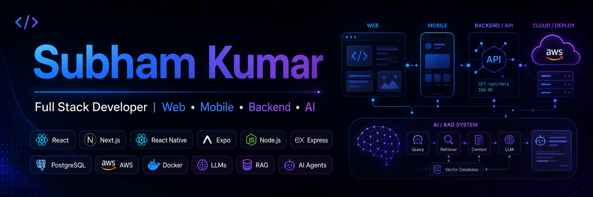

<h1 align="center">Hi 👋, I'm Subham Kumar</h1>

<h3 align="center">
Full Stack Developer | React.js | React Native | Node.js | AI/RAG Applications
</h3>

I build scalable web, mobile, backend, and AI-powered products with real-world users and business impact.

<!-- Add your banner image here after uploading it to your profile repo -->

<!-- Recommended path: ./assets/github-banner.png -->

  

  
  
  

  

---

## 👨‍💻 About Me

* 🚀 Software Development Engineer - I at **Codebucket Solutions**
* 💻 I work with **React.js, TypeScript, Next.js, React Native, Expo, Chrome Extensions, Node.js, Express.js, MySQL, PostgreSQL, AWS, and Docker**
* 🤖 Building AI-powered products using **LLMs, RAG, AI Agents, OpenAI API, and Claude API**
* 📱 Experienced in building **mobile apps, ERP systems, dashboards, backend APIs, and production workflows**
* ⚙️ I enjoy solving real-world product problems across **frontend, backend, mobile, cloud, and AI**
* 🌱 Currently improving my skills in **system design, cloud deployment, AI automation, and scalable product engineering**
* 💬 Ask me about **React, Next.js, Node.js, Express, React Native, Expo, APIs, AI/RAG apps, and browser extensions**
* 📫 Reach me at **[shubhamkr354@gmail.com](mailto:shubhamkr354@gmail.com)**
* 🌐 Portfolio: **https://subhams.site/**

---

## 🧠 What I Do

### 🔹 Frontend Engineering

I build clean, scalable, and maintainable user interfaces using **React.js, Next.js, TypeScript, React Query, Redux Toolkit, Tailwind CSS, and reusable component patterns**.

I have worked on complex business workflows including forms, tables, dashboards, validations, role-based UI states, API-driven screens, and production-grade ERP modules.

### 🔹 Mobile App Development

I build mobile applications using **React Native and Expo**, focusing on business workflows, role-based access, data entry, reporting, field operations, and user-friendly mobile experiences.

### 🔹 Backend Engineering

I develop backend systems using **Node.js, Express.js, REST APIs, MySQL, PostgreSQL, MongoDB, Redis, authentication, RBAC, and scalable service patterns**.

### 🔹 AI & Automation

I work with **LLMs, RAG, AI Agents, prompt engineering, OpenAI API, and Claude API** to build AI-powered workflows, knowledge systems, document-based intelligence, and automation tools.

### 🔹 Browser Extensions

I build privacy and productivity-focused browser extensions using **Chrome Extensions, Manifest V3, JavaScript, and Browser APIs**.

---

## 🛠️ Tech Stack

### Frontend

  

### Mobile & Cross-Platform

  
  
  

### Browser Extensions

  
  
  

### Backend & Databases

  

### Cloud, DevOps & Tools

  

### AI / GenAI

  
  
  
  
  
  

---

## 💼 Professional Experience

### Codebucket Solutions Pvt. Ltd.

**Software Development Engineer - I**

* Delivered production workflows across **ERP, mobile apps, backend systems, real-time features, and AI-powered products**
* Engineered complex **React.js and TypeScript workflows** for a **200+ module ERP system**
* Built reusable frontend components, financial forms, document locking flows, security checks, and standardized input handling
* Worked on the **COMFED/Sudha React Native application** used by **50K+ users**
* Developed backend services handling **10K+ daily API requests**
* Built real-time and asynchronous workflows using **REST APIs, Socket.IO, Redis, SQS, workers, clusters, and cron jobs**

### Walsis eConnect India Pvt. Ltd.

**Software Developer**

* Built and scaled student dashboard features for **Sarthaks.com**
* Improved UI performance, admin workflows, schema-based data handling, SSR, and SEO performance
* Resolved critical production issues and contributed to engagement-focused features

---

## 📊 GitHub Stats

  

  

  

---

## 🌐 Connect With Me

  
  
  
  

---

  <b>Building useful products. Solving real problems. Learning every day.</b>

